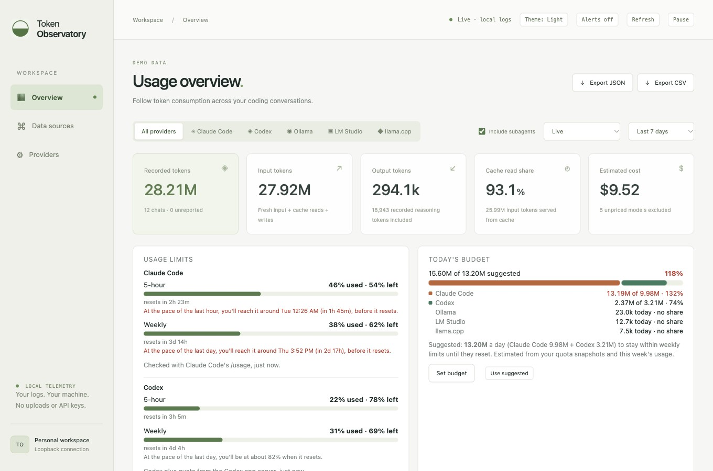
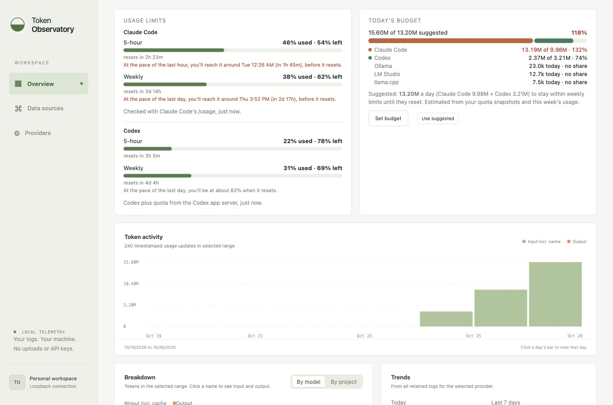
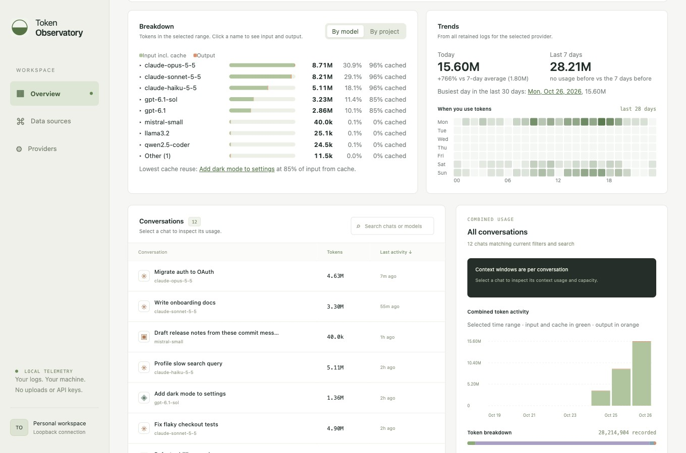
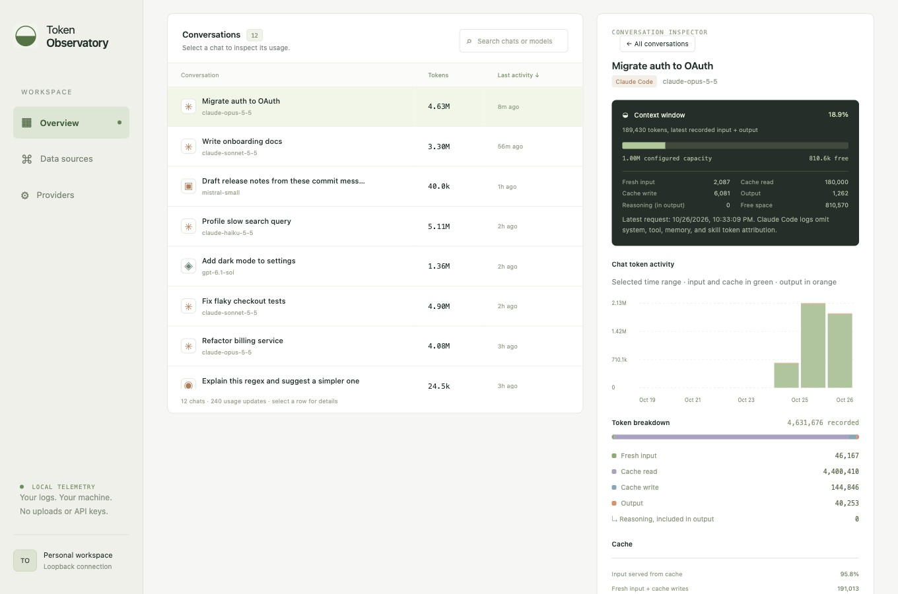
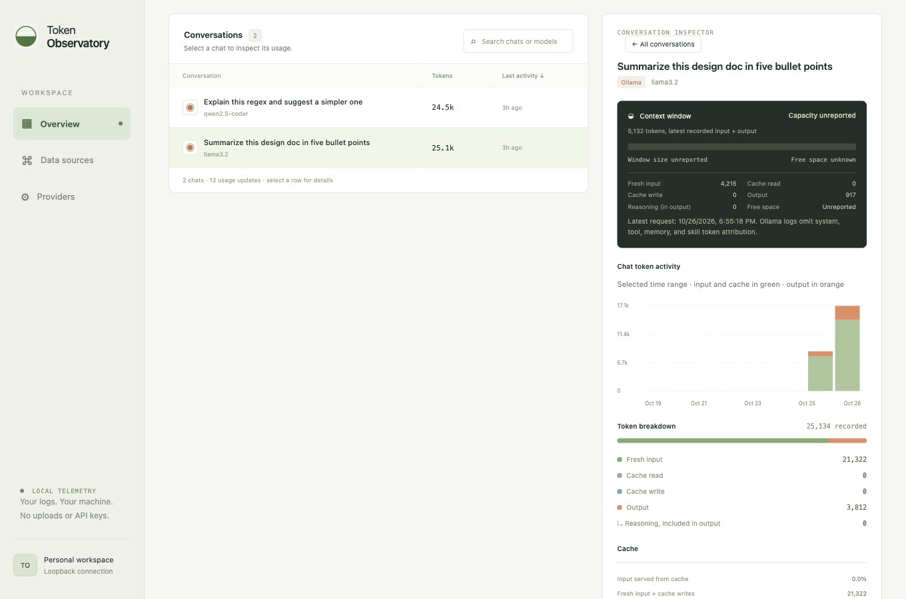
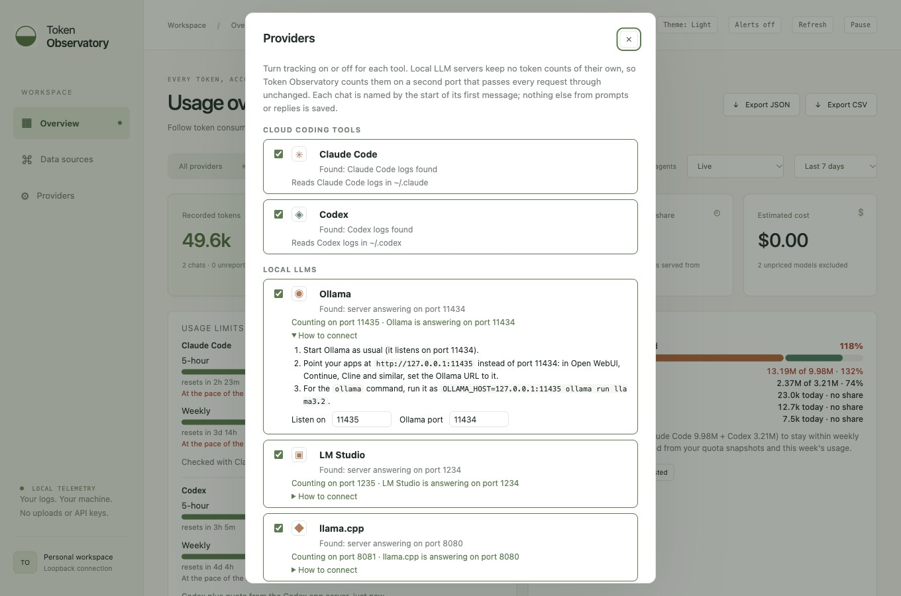

# Token Observatory

See how many tokens your Claude Code, Codex and local LLM (Ollama, LM Studio, llama.cpp) chats use, live, in a dashboard on your own computer. It reads the logs Claude Code and Codex already save, reads saved LM Studio desktop chats, and counts local API requests on a pass-through port. Nothing is uploaded and no API key is needed. It makes two kinds of read-only network requests, both optional: published model prices for the cost estimate (see [INSTALL.md](INSTALL.md#cost-estimates)) and a daily check for a new version on GitHub (see [INSTALL.md](INSTALL.md#updates)).

## Download

Get the latest version from [Releases](https://github.com/lepotatoguy/token_observatory/releases/latest).

| Your computer | Download |
|---|---|
| Mac with Apple silicon (M1 or later) | `TokenObservatory-<version>-macos-arm64.zip` |
| Windows | `TokenObservatory-<version>-windows-x64.exe` |
| Ubuntu or Debian Linux | `TokenObservatory-<version>-linux-amd64.deb` |

## Install and open

**Mac.** Unzip the file and drag **Token Observatory** into Applications. The first time, right-click it and choose **Open** (macOS warns because the app isn't from the App Store).

**Windows.** Double-click the `.exe`. If Windows shows "Windows protected your PC", choose **More info**, then **Run anyway**.

**Linux.** Install it, then open **Token Observatory** from your app menu or run `token-observatory`:

```sh
sudo apt install ./TokenObservatory-<version>-linux-amd64.deb
```

The dashboard opens in your browser at <http://127.0.0.1:8765>. The first launch can take up to a minute.

## Using it

- **Conversations** lists your chats. Click one to see its details; click it again to go back to the combined view.
- **Tokens** and **Last activity** sort the list. Click again to reverse.
- **Providers** (left sidebar) turns tracking on or off for Claude Code, Codex, Ollama, LM Studio and llama.cpp. The first time you open the dashboard it asks which tools you use, with the ones it found already ticked.
- **Local LLMs:** chats made inside LM Studio are read automatically from its saved chat files. For API requests from other apps, point them at the counting port: Ollama `http://127.0.0.1:11435`, LM Studio `http://127.0.0.1:1235/v1`, or llama.cpp `http://127.0.0.1:8081/v1`. See [Local LLMs](INSTALL.md#local-llms).
- Filter by provider and time range, or search by name or model.
- **Export CSV** and **Export JSON** save what you're looking at.
- A saved copy is kept for each day. Pick a date next to the time range to look back.
- Click any day's bar in **Token activity** to see just that day. Click the date chip to go back.
- **Usage limits** shows how much of your Claude and Codex 5-hour and weekly quota you've used and when each resets. Under each limit, a forecast says when you'll reach it at your recent pace (the last hour for the 5-hour limit, the last day for the weekly one), or how full it will be when it resets. When a limit you had used at least halfway resets, the card says so, and with **Alerts** on you also get a desktop notification. **Refresh** (top right) asks Claude Code and Codex for the current numbers, and the collector also checks every 5 minutes. Opening or reloading the dashboard checks too.
- **Today's budget** compares today's tokens with a suggested daily amount that keeps you within your weekly limits. The meter has one part for Claude Code and one for Codex, each sized by that tool's suggested share, with a line per tool underneath. You can also set your own target.
- **Estimated cost** (top row) prices your tokens at published API list prices, per model. Anthropic's prices are downloaded about once a day; if that fails, the prices bundled in `prices.json` are used. Models with no known price are left out and named in the card's tooltip.
- **Breakdown** splits usage by model or project. Each row has a meter split into input and output; click a name to see fresh input, cache read, cache write, output and cost, and click **Other** to list the models or projects grouped there. **Trends** compares today with your recent average and shows when you use tokens most.
- Turn on **Alerts** (top right) for a desktop notification when a chat's context is almost full, you pass your budget, or a usage limit resets.
- **Theme** (top right) switches between Auto (follows your system), Light and Dark.

- Optional **conversation hooks** (see [INSTALL.md](INSTALL.md#conversation-hooks)): near a reported usage limit, the running Claude Code or Codex chat is asked to pause for that window and save a handoff; same-chat resumption is supported after reset; when its context passes 60%, it is asked to condense and continue.
- **Limit controls**: per-provider warn or hard-limit mode, adjustable thresholds, reset notifications, and a metadata-only 30-day event history capped at 1,000 events / 256 KiB. Pauses clear automatically at reset; an idle chat still needs its host to run it.

- **Updates.** When a new version is out, the dashboard asks whether to update. **Update now** downloads it, checks it, installs it and reloads the page; **Not now** skips that version. Untick **Notify me about future updates** to stop asking; the link at the bottom right turns it back on. See [INSTALL.md](INSTALL.md#updates).

Numbers update after each reply finishes, not while it's being written.

Token Observatory keeps collecting in the background after you close the browser. Open the app again to bring the dashboard back. To stop it:

| Mac | Windows | Linux |
|---|---|---|
| `"/Applications/Token Observatory.app/Contents/MacOS/TokenObservatory" --stop` | `TokenObservatory-<version>-windows-x64.exe --stop` | `token-observatory --stop` |

## Screenshots

Screenshots use synthetic demo data (`python3 docs/screenshots/demo.py` serves it).

**Overview:** totals, provider and time filters for Claude Code, Codex, Ollama, LM Studio and llama.cpp, estimated cost, usage limits and today's budget.



**Usage limits and budget:** 5-hour and weekly limits for Claude Code and Codex with reset times and a forecast at your recent pace, today's budget split by tool, and token activity by day.



**Breakdown and trends:** usage by model or project with cache reuse, today against your 7-day average, and when in the week you use tokens.



**Conversation details:** context usage, a timeline, and the input, cache, output and reasoning breakdown.



**Local LLMs:** Ollama, LM Studio and llama.cpp chats, each named by its first message.



**Providers:** turn each tool on or off and see how to connect local servers, with live status. The same dialog opens on first run with the tools it found already ticked.



## Good to know

- Only chats saved on this computer appear. Chats on claude.ai or chatgpt.com don't.
- Claude Code doesn't record the size of its context window. Token Observatory assumes 1M tokens for the models Claude Code documents as 1M by default (Opus 4.7 and later, Sonnet 5 and later, Haiku 5.5); you can set other models yourself (see [INSTALL.md](INSTALL.md#claude-context-window)).
- Cost is an estimate at list API prices, not a bill: subscription plans, discounts and batch pricing aren't modelled, and OpenAI prices in `prices.json` are partly estimated. You can correct any price in `config.json`.
- Values a tool doesn't record are shown as "Unreported", never guessed.

## More

- [INSTALL.md](INSTALL.md): installing from source, settings, updating, uninstalling, troubleshooting
- [DEVELOPMENT.md](DEVELOPMENT.md): how the numbers are calculated, data files, building and releasing
- [CONTRIBUTING.md](CONTRIBUTING.md): how to help
- [CHANGELOG.md](CHANGELOG.md): what changed in each version
- [LICENSE](LICENSE): MIT
