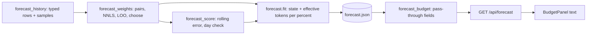

# Design

## Feature: Token-type calibration and budget backtest

## Context
Stack: Python 3 and Flask backend, React and TypeScript frontend, pytest and Vitest, runtime dependencies only `flask`, `pydantic`, and `requests`. This feature builds on `specs/daily-budget-forecast` as it stands on `main`.

Existing code touched or reused:
- `backend/services/forecast_history.py`: `collect()` returns a frozen `History` with `events` (`(seconds, total tokens)` per provider), daily `series`, `samples` (`Sample(t, percent, resets_at)`), and warnings. It dedups sessions newest-copy-wins. The typed rows are added here.
- `backend/services/forecast_calibrate.py`: `segments()` and `pairs_in()` define reading pairs; `tokens_per_percent()` pools them with the zero-token and 4x-median filters. The pairing and filters are reused, not copied.
- `backend/services/forecast.py`: `Forecaster.fit()` assembles the stored state (`forecast.json`, schema 1) once per day; `payload()` applies it to live limits.
- `backend/services/forecast_budget.py`: `entry()` returns the per-provider budget; it uses the stored `tokens_per_percent` and demand weights. It gains pass-through fields only.
- `frontend/src/components/insights/BudgetPanel.tsx`: `forecastExplanation()` writes the plain-language paragraph; `frontend/src/types/forecast.ts` types the response.
- Tests: `tests/test_services/test_forecast*.py`, `tests/test_api/test_forecast_api.py`, `frontend/src/components/insights/insights.test.tsx`.

Facts from this machine's data (read-only, aggregates, one run, offline): per-type fitting lowered the leave-one-out error for Codex (70 pairs) from 2.22 to 1.62 percentage points and raised it for Claude (6 pairs) from 2.87 to 4.42. Fitted Codex weights were about 3.3 percent per million for input, 0.09 for cached, 48 for output, and 0 for write. These are single observations, not benchmarks.

## Goals and non-goals
- Goals: per-type calibration with a safe fallback, held-out scores for calibration and for past days, plain-language display.
- Non-goals: per-model weights, more readings, changing demand weights, new dependencies, new endpoints.

## High-level design

The fit stays once per day. The budget formula in `forecast_budget.py` does not change: it still multiplies a stored tokens-per-percent value by the percent left. For the by-type method that stored value is the effective tokens per percent, `1 / sum(weight_t * mix_t)`, using the user's recent token mix. Because the weights are fitted on all pairs but the mix is from the last 7 days, the budget size follows how the user has recently spent tokens, which is the intended gain over one pooled ratio. If the recent mix matches the pooled mix, the size will be close to the single ratio.

## Components

### `forecast_history.py` (edit)
`History` gains `typed: dict[str, list[tuple]]`, sorted rows `(seconds, input, cached, write, output)` per provider inside the window. `collect()` builds them in the same loop that builds `events`, using `COUNTED` fields in the order input, cached, write, output. `events` is unchanged, so existing consumers and tests keep working. Invariant tested: for each event the typed row sums to the event's total.

### `forecast_weights.py` (new, about 170 lines)
- `TYPES = ('input', 'cached', 'write', 'output')`.
- `Pair`: frozen dataclass `(t_end: float, rise: float, tokens: tuple[float, float, float, float])` with tokens in millions.
- `typed_pairs(samples, typed) -> list[Pair]`: uses `forecast_calibrate.segments` and `pairs_in`, sums typed tokens between the two readings with prefix sums and `bisect`, drops pairs with zero tokens, then drops pairs whose `rise / total tokens` ratio is outside four times the median ratio (same rule as the single ratio). Output is sorted by `t_end`.
- `fit_nnls(pairs) -> tuple[float, ...] | None`: exact non-negative least squares for four columns. For each non-empty subset of columns (15), solve the normal equations by Gaussian elimination with a relative ridge of 1e-9 on the diagonal; skip singular subsets and subsets with a negative weight; keep the feasible solution with the smallest squared error. The best feasible subset solution is the NNLS optimum for this size, so no iterative solver is needed. Ties go to the earlier subset order, which keeps the result deterministic.
- `single_ratio(pairs) -> float | None`: sum of rises divided by sum of total tokens (percent per million tokens); identical in meaning to the existing pooled ratio on the same pairs.
- `loo_errors(pairs) -> LooErrors(single, by_type | None)`: leave-one-out mean absolute error in percentage points. The by-type error is computed only when `len(pairs) >= MIN_TYPED_PAIRS` (20).
- `choose(pairs) -> Calibration`: `by_type` when pairs are at least 20 and `by_type <= 0.9 * single`; otherwise `single`. Returns kind, weights (or `None`), single ratio, both errors, and pair count.
- `effective_tokens_per_percent(weights, mix) -> float | None`: `1 / sum(w_t * m_t)` in tokens per percent, or `None` when the sum is zero.
- `recent_mix(typed, today, days=7) -> tuple | None`: type shares over the last 7 local days before today, or `None` when there are no tokens.

### `forecast_score.py` (new, about 150 lines)
- `rolling_errors(pairs, kind) -> Rolling | None`: for index `i` from 5, fit on `pairs[:i]` (by-type only when `kind == 'by_type'` and `i >= 20`, otherwise the single ratio), predict `pairs[i].rise` from its tokens, and accumulate absolute error; also accumulate the single-ratio error over the same indices. Returns `mae_points`, `single_mae_points`, `readings`, or `None` below 6 pairs. Cost is one NNLS per step, about 100 NNLS fits for 100 pairs.
- `day_check(samples, typed, pairs, kind, demand_weights, today) -> Check | None`: for each of the last 30 local days before today, find the latest reading before the day's start that is at most 12 hours old, has a known `resets_at` later than the day's start, and belongs to the same weekly window. Capacity at the day's start is `k_asof * (100 - percent) + tokens logged between the reading and the day's start`, where `k_asof` is the effective tokens per percent from a fit on the pairs that ended before the day (single ratio when fewer than 20 pairs, or when kind is `single`) and the mix of the 7 days before that day. The day's share is its demand weight over the sum of weights from that day to the reset, scaled by the fraction of each day inside the window, as in `forecast_budget.day_weights`. The day is within budget when the tokens that day are at most `capacity * share`. Returns `within` and `scored`, or `None` below 5 scored days. The function reuses `forecast_budget.day_weights` and `midnight` instead of duplicating them.

### `forecast.py` (edit)
`fit()` builds pairs, calls `choose`, derives `tokens_per_percent` (single ratio, or effective for `by_type`), `rolling_errors`, and `day_check`, and stores them. The single ratio stored for the `single` kind stays in tokens per percent, as before, so state written by this version and the previous one stay compatible for the budget. The state schema number stays 1: new keys are additive, and a state file without them is still valid (the budget treats missing keys as `null`). The stored provider entry gains:
```
"calibration_model": {"kind": "single|by_type", "weights": [4 floats] | null,
                       "mix": [4 floats] | null, "readings": 70,
                       "loo_single": 2.2, "loo_by_type": 1.6 | null},
"rolling": {"mae_points": 1.5, "single_mae_points": 2.1, "readings": 64} | null,
"budget_check": {"within": 14, "scored": 20} | null
```

### `forecast_budget.py` (edit)
`entry()` copies `calibration_kind`, `calibration_readings`, `rolling`, and `budget_check` from the stored entry into the returned entry, with `null` defaults. The budget arithmetic is untouched.

### Frontend
- `types/forecast.ts`: add `calibration_kind`, `calibration_readings`, `rolling`, `budget_check`.
- `BudgetPanel.tsx`: `Part` carries the new fields; `forecastExplanation()` replaces the generic "how it is forecast" first sentence for calibration with per-provider plain-language sentences: by-type text (AC-7.2), the rolling error against the single-ratio error (AC-7.3), the budget check count (AC-7.4), and the single-ratio message (AC-7.5). The existing sentences about weekday demand and the fallback providers stay.

## Data model
See the stored keys above. Typed rows are held in memory only during a fit and are not stored.

## API / interface design
`GET /api/forecast` is unchanged in method and path; each provider entry gains the four fields. Example of the shape (placeholders, not results): `"calibration_kind": "by_type"`, `"calibration_readings": 70`, `"rolling": {"mae_points": 1.5, "single_mae_points": 2.1, "readings": 64}`, `"budget_check": {"within": 14, "scored": 20}`. `rolling` and `budget_check` are `null` when not computed.

## Security and access control
The endpoint stays read-only behind the existing middleware. The added fields contain only counts, weights, shares, errors, and dates. No network access is added (AC-3.2).

## Error handling

| Failure | Detection | Response |
|---|---|---|
| Singular or all-zero token columns | Gaussian elimination pivot below tolerance | Skip that subset; weight stays zero |
| No feasible subset | Search returns none | Use the single ratio, `calibration_kind = single` |
| Effective sum is zero | `effective_tokens_per_percent` returns `None` | Use the single ratio |
| Fewer pairs than a minimum | Length checks | Report `null` for the missing score; never a default number |
| Old state file without the new keys | Missing keys in `entry()` | Return `null` values; budget still computed |
| Reading without `resets_at` for the day check | Field is `None` | That day is not scoreable |

## Performance and scalability
Pairs number in the tens to low hundreds. Leave-one-out costs one NNLS per pair and the rolling replay one per step, each at most 15 four-by-four solves. The estimate is well under 0.5 seconds for 100 pairs (to be measured by the test in NFR-2). The larger cost is the typed rows during `collect()`: five values per event instead of two, about 1.2 million rows in the timing test; the cold fit is currently 1.9 seconds on this machine and must stay under 3 seconds. If it does not, the typed rows will be built only for events at or after the oldest reading time.

## Testing strategy
Backend (pytest, synthetic data with known answers):
- `test_forecast_history.py`: typed rows sum to the totals and follow the same dedup (REQ-1).
- `test_forecast_weights.py`: NNLS recovers known weights from noiseless pairs, clips a negative true weight to zero, is deterministic, handles an all-zero column; the pair filters; LOO errors on constructed data; `choose` picks `by_type` on data generated by distinct type weights with 25 pairs, `single` below 20 pairs, and `single` when types are indistinguishable; effective tokens per percent and mix fallbacks (REQ-2, REQ-3, REQ-4).
- `test_forecast_score.py`: rolling replay never uses later pairs (checked by making the last pair an outlier and seeing earlier predictions unchanged), error numbers match a hand-computed small case, `null` below 6 pairs; day check with a hand-built week: within and over-budget days, reading too old, reading from another window, fewer than 5 scoreable days returns `null` (REQ-5, REQ-6, NFR-4).
- `test_forecast.py` and `test_forecast_api.py`: new keys stored and returned, old state files accepted, no private fields, timing for NFR-2.
Frontend (Vitest): sentences for by-type, rolling error, budget check, and single-ratio messages (AC-7.2 to AC-7.5).
Cross-platform (NFR-1, root `AGENTS.md`): suites run natively on macOS, Windows, and Linux, recorded in the verification note; only macOS is available in this session, so the other two are reported as gaps.

## Alternatives considered and tradeoffs
- Per-model weights: rejected; the readings are too few to split further.
- Fixed cache-discount weights (for example cached at 0.1): rejected; they are a guess, and on this data they did worse than the learned weights on Codex and worse than the single ratio on Claude.
- Iterative NNLS solver or gradient descent: rejected; with four columns the subset search is exact, short, and deterministic.
- Always using the by-type fit: rejected; with 6 Claude pairs it was worse than the single ratio.
- Scoring the budget by simulating that the user followed it: rejected as not observable; the check counts past days against the as-of budget instead.
- Showing leave-one-out error in the panel: rejected in favour of the rolling error, which only uses earlier data and so is closer to how the budget is used; leave-one-out is used only to choose the method.

## Risks and mitigations
- The budget size now depends on the assumed future token mix. Mitigation: the recent 7-day mix, a stored mix for inspection, and the single ratio as fallback.
- Few readings make the by-type fit unstable. Mitigation: 20-pair minimum, 10% margin, and non-negative weights.
- The as-of day check uses the final demand weights and a nearest reading up to 12 hours old. Mitigation: only days with a nearby reading are scored, the count is shown, and fewer than 5 days returns `null`.
- Usage outside the local logs still moves the percent without logged tokens, as before. Mitigation: the zero-token and outlier pair filters remain.
- Cold fit time rises with typed rows. Mitigation: measured against the existing timing test, with a stated fallback.

## Requirements traceability

| Requirement | Component(s) | Test layer |
|---|---|---|
| REQ-1 | `forecast_history` | unit |
| REQ-2 | `forecast_weights` | unit |
| REQ-3 | `forecast_weights.choose`, `loo_errors` | unit |
| REQ-4 | `forecast_weights.effective_tokens_per_percent`, `recent_mix`, `forecast.fit` | unit, integration |
| REQ-5 | `forecast_score.rolling_errors` | unit |
| REQ-6 | `forecast_score.day_check` | unit |
| REQ-7 | `forecast_budget`, `routes`, `BudgetPanel`, `forecast.ts` | integration, frontend |
| NFR-1 | all new modules | unit, native three-OS runs |
| NFR-2 | `forecast_history`, `forecast_weights`, `forecast_score` | timing tests |
| NFR-3 | `forecast`, `forecast_budget` | unit, no-network test |
| NFR-4 | `forecast_weights`, `forecast_score` | unit |
| NFR-5 | test files above | CI and local runs |
