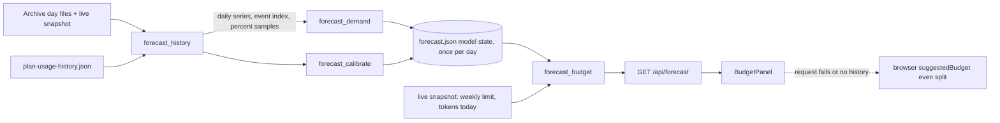

# Design

## Feature: Demand-weighted daily budget forecast

## Context
Stack: Python 3 and Flask backend (`backend/`), React and TypeScript frontend (`frontend/src`), pytest for backend tests and Vitest for frontend tests, `pyproject.toml` runtime dependencies are only `flask`, `pydantic`, and `requests`.

Existing code this feature touches or reuses:
- `backend/services/store.py`: `Store.read()` returns the snapshot (`sessions`, `limits`, `providers.enabled`, `at`). `Store.archive` is an `Archive`; `Store.plan_usage` is a `claude_limits.PlanUsage`. The app data folder is `Path(config.DATA_DIR).parent` (the same convention `limit_control.Control` and `float_control.Float` use in `backend/app.py`).
- `backend/services/archive.py`: `Archive.dates()` lists local-date snapshot names newest first, and `Archive.load(day)` returns one snapshot or raises `FileNotFoundError` or `ValueError`. Snapshot files are named by local date, and a session that is not in a newer capture is retained in the day file.
- `backend/services/quota.py`: `pick(limits, WEEKLY_MINUTES, 'secondary')` returns the weekly window as `used_percent`, `window_minutes`, `resets_at`. It is reused, not reimplemented.
- `backend/services/claude_limits.py`: `PlanUsage` reads only the newest desktop usage sample today and deliberately never reads the organization id. It gains a `samples()` method that returns all samples with the same privacy rule.
- `backend/parsers/_helpers.py`: `total()` defines the token total (`input + cached + write + output`, reasoning excluded). The forecast uses the same definition.
- `backend/api/routes.py`: blueprint `dashboard` mounted at `/api`; services come from `current_app.extensions`.
- `frontend/src/components/insights/BudgetPanel.tsx`: `suggestedBudget()` computes the even split in the browser; the panel, the "Change budget" form, "Use suggested", and the 80% and 100% alerts stay.

Facts checked on this machine's real data (read-only, aggregates only): the archive holds 22 daily files; loading all of them took 0.33 seconds in one run; archived sessions include `rate_limits` for Codex (106 distinct weekly samples with `resets_at`); `plan-usage-history.json` holds 44 Claude samples over 22 days with no reset time; MiniMax appears only in the per-day `limits` capture; daily totals vary by roughly ten times between days. These are single observations, not benchmarks.

## Goals and non-goals
- Goals: demand-weighted, history-calibrated suggested budget, once-per-day fit, live application to current limits, standard-library implementation.
- Non-goals: per-model budgets, session-window budgets, enforcement, new dependencies, panel redesign.

## High-level design
The work splits into an expensive part that runs once per day (reading up to 30 days of history and fitting) and a cheap part that runs on every request (applying the fit to the live weekly limit).



Flow per request: `Forecaster.payload()` checks the stored model state date. If it is not today (or refresh was requested and the minimum refit interval has passed), it reads history, fits demand and calibration per provider, and writes `forecast.json` atomically. It then calls `forecast_budget.budget()` with the stored state and the live snapshot, and returns the result.

The budget formula for one provider:
1. Weekly window: `resets_at`, `used_percent`, `window_start = resets_at - window_minutes * 60`.
2. Tokens per percent `k`: from history if available, else the current-week ratio computed live from the snapshot (tokens used from `window_start` to the sample time, divided by `used_percent`).
3. `remaining = k * max(0, 100 - used_percent)`; `used_today` = provider tokens since `max(window_start, today_start)`; `start_capacity = remaining + used_today`.
4. For each local day from today through the day of `resets_at`: `weight_d = weekday_weight[d.weekday()] * fraction_d`, where `fraction_d` is the part of that day inside `[max(window_start, today_start), resets_at]`, divided by that day's real length (so daylight-saving days of 23 or 25 hours are handled).
5. `budget_today = start_capacity * weight_today / sum(weight_d)`.

Because the budget is a share of the capacity the day began with, it stays steady while the day passes and moves only when calibration or the weekly percent changes. When `weekday_weight` is flat the budget is the calibrated even split.

## Components

### `backend/services/forecast_history.py` (new, about 150 lines)
Reads history once per fit.
- `collect(snapshot, archive, plan_samples, today, providers, days=30) -> History` where `History` is a frozen dataclass: `events: dict[str, list[tuple[float, int]]]` (sorted `(at, tokens)` per provider), `series: dict[str, list[int]]` (daily totals oldest first, zero-filled from the first event inside the window to yesterday), `first_day: dict[str, date]`, `samples: dict[str, list[Sample]]`, `skipped_events: int`, `warnings: list[str]`.
- Dedup by session id with newest-wins: the live snapshot is consumed first, then archive files from newest to oldest, skipping any session id already seen. Each file is loaded at most once.
- `Sample` is a frozen dataclass `(t: float, percent: float, resets_at: float | None)`. Sources: `rate_limits` of archived sessions (weekly window via `quota.pick`), the `limits` of each archived snapshot and of the live snapshot (via `quota.pick`), and `PlanUsage.samples()` for Claude. Duplicate samples (same provider, `t` rounded to the second, same percent) are dropped.
- Unreadable snapshot files add a warning and are skipped.

### `backend/services/forecast_demand.py` (new, about 120 lines)
Demand weights per weekday.
- `fit_demand(series: list[int], last_day: date) -> Demand`, a frozen dataclass with `method`, `weekday_weights: tuple[float, ...]` (7 values, Monday first), `shrinkage: float`, `backtest: Backtest | None`.
- Model: the level for a day is the mean of the previous 14 days (the flat baseline). The weekday ratio `r_w` is the mean usage on weekday `w` divided by the overall mean over the training days. The weight is `(1 - lam) + lam * r_w` with shrinkage `lam` in `{0, 0.25, 0.5, 0.75, 1}`, floored at 0.05 so every weight is positive. This is a one-parameter regularized regression: `lam = 0` is the flat baseline and larger values trust the weekday pattern more.
- Selection (needs at least 18 days): rolling-origin backtest where each day from index 14 onward is predicted from earlier days only, as `level * weight`. The `lam` with the lowest mean absolute error is chosen, ties go to the smaller `lam`. If the best `lam` is 0 or fewer than 18 days exist, `method = 'flat'` and all weights are 1.0. Otherwise `method = 'weekday_regression'`.
- Output reports `model_mae` and `baseline_mae` in tokens from the backtest, or `None` when no backtest ran.
- Confidence: `low` below 7 days, `medium` from 7 to 17, `normal` from 18.

### `backend/services/forecast_calibrate.py` (new, about 110 lines)
Tokens per percent from history.
- `tokens_per_percent(samples, events) -> Calibration | None` with `value`, `pairs`.
- Samples are sorted by time and split into segments: a new segment starts when the percent drops, or when both samples have `resets_at` and they differ by more than one hour.
- Pairs: within a segment, start at sample `i` and extend to the first `j` where percent rose by at least 2 points; the next pair starts at `j`. For each pair, tokens between the two times come from the event index with `bisect` over prefix sums.
- Pairs with zero tokens are dropped (the percent moved because of usage the local logs do not show). Of the rest, pairs whose ratio is outside four times above or below the median ratio are dropped. The estimate is the sum of tokens divided by the sum of percent over the remaining pairs. With no remaining pair it returns `None`.

### `backend/services/forecast_budget.py` (new, about 130 lines)
Pure function, no I/O: `budget(state, snapshot, now) -> dict`. Applies the formula above per enabled provider. Excludes a provider with `excluded = 'no_weekly_quota'` (no weekly window, no `resets_at`, or `resets_at` not in the future) or `'no_calibration'` (neither history nor current-week calibration works). Carries `resets_estimated` as `estimated`.

### `backend/services/forecast.py` (new, about 110 lines)
`Forecaster(store, folder)`: owns the lock, the `forecast.json` file, and the minimum refit interval.
- `payload(refresh=False, now=None) -> dict`: ensure today's state, then return `forecast_budget.budget(...)`.
- State read and write: `forecast.json` is written through a temporary file in the same folder and `os.replace`. A state file with a different `schema_version`, a past date, or invalid JSON is treated as absent.
- Refresh is ignored when the last fit was less than 60 seconds ago (the stored state is returned).

### `backend/api/routes.py` and `backend/app.py` (small edits)
`GET /forecast` calls `services()['forecast'].payload(refresh=request.args.get('refresh') == '1')`. `create_app` builds `app.extensions['forecast'] = Forecaster(store, folder)` next to the other services.

### Frontend
- `frontend/src/types/forecast.ts` (new): `Forecast` and `ForecastProvider` types.
- `frontend/src/api/client.ts`: `api.forecast(refresh?)`.
- `BudgetPanel.tsx`: a small `useForecast(active)` effect fetches on mount and every 60 seconds, and not while `historyDay` is set. `suggested` becomes a merge: for each provider, the forecast value if present, otherwise the browser value marked as an even split. `suggestedBudget()` stays as the fallback and keeps its signature so the existing tests still apply. The note states confidence and days used, and marks any even-split provider.

## Data model
`forecast.json` in the app data folder:

```
{
  "schema_version": 1,
  "date": "YYYY-MM-DD",            // local date the fit was made
  "generated_at": 1793993152.6,
  "skipped_events": 2,
  "warnings": ["..."],
  "providers": {
    "claude": {
      "days_used": 22,
      "confidence": "normal",
      "tokens_per_percent": 123456.0,   // null when history gave no estimate
      "calibration_pairs": 9,
      "demand": {
        "method": "flat",               // or "weekday_regression"
        "weekday_weights": [1,1,1,1,1,1,1],
        "shrinkage": 0.0,
        "backtest": {"model_mae": 0, "baseline_mae": 0, "days": 8} // or null
      }
    }
  }
}
```
It holds only counts, ratios, dates, and warnings (NFR-3). No migration is needed; an unreadable or old file is simply refitted.

## API / interface design

| Method | Path | Input | Success | Errors |
|---|---|---|---|---|
| GET | `/api/forecast` | optional `refresh=1` | 200 JSON below | none expected; internal faults return 200 with `warnings` and no budgets |

Response body:
```
{
  "date": "YYYY-MM-DD", "generated_at": 1793993152.6, "total": 571860000,
  "warnings": [],
  "providers": {
    "claude": {
      "daily": 363520000, "share": 0.14, "start_of_day_capacity": 2.5e9,
      "remaining_capacity": 2.4e9, "used_today": 1.0e8,
      "demand_method": "flat", "calibration": "history",     // or "current_week"
      "confidence": "normal", "days_used": 22, "estimated": false,
      "excluded": null, "warnings": []
    }
  }
}
```
`excluded` is `null`, `"no_weekly_quota"`, or `"no_calibration"`; an excluded provider has `daily: null`. The numbers in the examples are placeholders for the shape, not results.

## Security and access control
- The endpoint is read-only and sits behind the existing `SecurityMiddleware`; it takes no body and accepts only the `refresh` flag.
- The response and `forecast.json` contain no prompt text, session titles, project names, organization id, or file paths (AC-6.7, NFR-3).
- No network access is added. `PlanUsage.samples()` reads only `t` and the two percentages.
- The refit interval limit (60 seconds) prevents a client from forcing repeated full history reads.

## Error handling

| Failure | Detection | Response | User-facing |
|---|---|---|---|
| Snapshot file unreadable | `OSError`, `ValueError`, `FileNotFoundError` from `Archive.load` | Skip file, add warning | Panel works; note may show a warning count |
| Forecast file unwritable | `OSError` on write | Return computed budget, add warning | None needed |
| Forecast file corrupt or old schema | `ValueError`, schema check | Treat as absent, refit | None |
| Archive not configured (`store.archive is None`) | None check | Providers excluded with `no_calibration` unless current-week works | Panel falls back to the browser value |
| Provider has fewer than 2 history days | `len(series) < 2` | Flat weights, confidence `low`, calibration may still work | Note shows low confidence |
| `/api/forecast` fails or times out | `fetch` rejection in the panel | Keep browser even split | Panel shows today's suggestion unchanged |
| Weekly window missing or `resets_at` in the past | Check in `budget()` | `excluded = no_weekly_quota` | Provider listed as excluded, as the panel does today |

## Performance and scalability
Fit reads each of at most 31 files once. The 22 real files loaded in 0.33 seconds in one run; the target is under 3 seconds for 30 files of 5 MB each (NFR-2), verified by a timing test on synthetic data. Warm requests read only the small `forecast.json` and the live snapshot already cached by `Store.read()`, targeting under 50 milliseconds. Memory holds one event list per provider (tens of thousands of tuples).

## Testing strategy
Backend (pytest, `tests/test_services/`, synthetic snapshots in `tmp_path`, no network):
- `test_forecast_history.py`: dedup newest-wins, local-day assignment, skipped events, zero-fill, history window, unreadable file (REQ-1, NFR-4).
- `test_forecast_demand.py`: flat under 18 days, regression only when it wins the backtest, positive weights, reported errors, confidence levels, determinism (REQ-2).
- `test_forecast_calibrate.py`: pairing, segment split on reset, 2-point minimum, zero-token and outlier pairs, fallback signals (REQ-3).
- `test_forecast_budget.py`: formula, start-of-day stability while the day advances, 100 percent used, window starting today, daylight-saving day length, excluded providers, estimated flag, no change to `Control` state (REQ-4).
- `test_forecast.py`: once-per-day fit, no archive read when state is fresh, atomic write, refresh interval, store write failure, no back-fill (REQ-5).
- `test_forecast_api.py`: endpoint shape, refresh, archive-less store, no private fields (REQ-6, AC-6.1, AC-6.2, AC-6.7).
- Timing test for NFR-2 and a no-network check for NFR-3 (patching `socket`).

Frontend (Vitest, `insights.test.tsx`): panel uses forecast values for total, split, button, and note; per-provider even-split fallback with label; request failure shows today's suggestion; history view ignores the forecast (REQ-6, AC-6.3 to AC-6.6).

Cross-platform verification (NFR-1, root `AGENTS.md`): the backend and frontend suites run natively on macOS, Windows, and Linux, with results and evidence locations recorded; the daylight-saving and path tests run on each. This change adds no widget, process, or installer behavior. Any platform not run is reported as an unverified gap, and the change is not described as fully verified until all three pass.

## Alternatives considered and tradeoffs
- XGBoost or scikit-learn gradient boosting: rejected. Each provider has at most 30 daily points, so a tree model would overfit, and it would add a heavy native dependency to the PyInstaller packaging on three operating systems.
- Full ridge regression with weekday dummies solved by normal equations: rejected for now. The shrinkage toward the flat baseline does the same regularization with one parameter and no matrix solve, and the backtest picks the strength.
- Computing the whole forecast on the frontend: rejected. It would need the archive history over the API on every load and cannot run once per day.
- Fitting on every request: rejected for cost; fitting once per day with live application keeps the budget responsive to the weekly percent.
- Budget as `used_today + share of remaining`: rejected because it shrinks as the day passes; the start-of-day capacity share stays steady.
- Storing only the day's final result: rejected because the weekly percent changes during the day; storing the model and applying it live avoids stale budgets.

## Risks and mitigations
- Usage outside the local logs (other machines, claude.ai chat) moves the weekly percent without local tokens, which biases tokens per percent low. Mitigation: drop zero-token pairs and outlier ratios; note that the current method has the same limit; expose `calibration_pairs`-based confidence later if needed.
- Few weekday observations (about four per weekday in 30 days) make weekday weights noisy. Mitigation: shrinkage chosen by backtest, with the flat baseline as the default winner.
- Sparse samples (44 Claude samples in 22 days) may give few valid pairs. Mitigation: the current-week fallback and a visible `calibration` field.
- Estimated weekly reset times (`resets_estimated`) shift the day count. Mitigation: carry the `estimated` flag to the note, as the panel does today.
- Daylight-saving transitions change day length. Mitigation: use real day boundaries from naive local datetimes and test the 23 and 25 hour days.

## Requirements traceability

| Requirement | Component(s) | Test layer |
|---|---|---|
| REQ-1 | `forecast_history` | unit (`test_forecast_history.py`) |
| REQ-2 | `forecast_demand` | unit (`test_forecast_demand.py`) |
| REQ-3 | `forecast_calibrate`, `claude_limits.PlanUsage.samples` | unit (`test_forecast_calibrate.py`) |
| REQ-4 | `forecast_budget` | unit (`test_forecast_budget.py`) |
| REQ-5 | `forecast` | unit and integration (`test_forecast.py`) |
| REQ-6 | `routes`, `app`, `client.ts`, `BudgetPanel.tsx` | integration (`test_forecast_api.py`), frontend (`insights.test.tsx`) |
| NFR-1 | all backend modules, native three-OS runs | unit and manual native verification |
| NFR-2 | `forecast_history`, `forecast` | timing test |
| NFR-3 | `forecast`, `routes` | unit, no-network test |
| NFR-4 | `forecast_history`, `forecast_demand` | unit |
| NFR-5 | test files above | CI and local runs |

## Revision after review
- When a provider has too little data (fewer than 2 calibration pairs, fewer than 7 days of history, or no stored calibration), `forecast_budget.budget()` returns it with `excluded = insufficient_data` and no budget, and the panel uses the previous browser even-split calculation for it. The server-side current-week calibration described above was removed, so `calibration` is `history` or `null`.
- Each budgeted provider also returns `shrinkage`, `calibration_pairs`, and `backtest` (model and baseline mean absolute error in tokens per day, and test days, or `null`). The panel shows one line per forecast provider naming the algorithm, the calibration readings and history days, and the measured error, or says accuracy is not measured yet.
