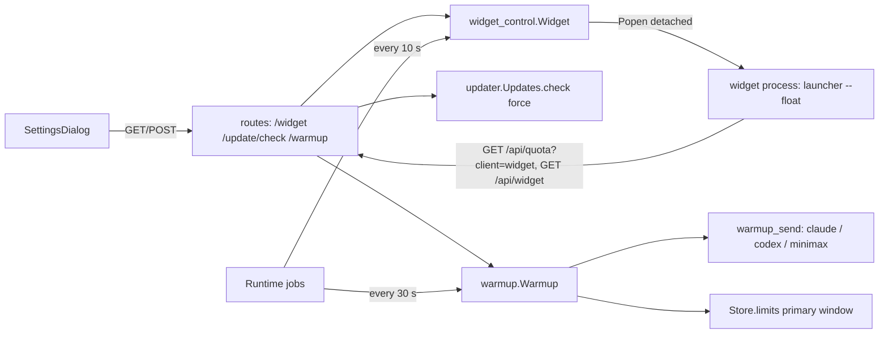

# Design

## Feature: Always-available floating widget, manual update check, and scheduled window warm-up

## Context
Stack: Python 3.10+ Flask backend (`backend/app.py` factory, blueprint at `/api` in `backend/api/routes.py`), React 18 + TypeScript frontend (zustand, `@tanstack/react-query`, vitest), PySide6 widget (`backend/services/float_window.py`, `float_panel.py`). Settings are small JSON files in the data folder, written atomically (pattern in `backend/services/providers.py` `Settings`: tempfile plus `os.replace`, `update()` raises `ValueError` mapped to HTTP 400). Background work runs as daemon threads in `Runtime.start()` (`backend/app.py`), each calling a callback on an interval. Provider tools are found with `backend/services/live_limits.py` `find_tool()` and `tool_env()`, and limits come from `Store.limits()` in `backend/services/store.py` via `backend/services/quota.py`. `POST` requests must be JSON and at most 1024 bytes (`validate_mutation` in `backend/app.py`).

Conventions reused: JSON settings plus a small service class per concern, `app.extensions[...]` registration, `(callback, interval)` jobs, spec format of `specs/daily-budget-forecast/`. New code goes in new modules (`widget_control.py`, `warmup.py`, `warmup_send.py`) to keep files small. Documentation and version bump follow `CONTRIBUTING.md`.

## Goals and non-goals
- Goals: discoverable widget with a persistent switch, widget runtime in every build, manual update check, opt-in scheduled warm-up for three providers.
- Non-goals: plan detection, OS-level scheduling, local tools, weekly window handling, a new update installer.

## High-level design



Widget: the server owns an on/off flag. A `Runtime` job calls `Widget.ensure()` every 10 seconds. When the flag is on and no widget has polled `GET /api/quota?client=widget` in the last 30 seconds, and no start was attempted in the last 30 seconds, it spawns `launcher --float` detached. The widget does not need to be killed by PID: on every 5-second poll it also reads `GET /api/widget` and quits itself when `enabled` is false or the collector is unreachable for 3 polls. This avoids stale PID files (a stale `float.pid` exists today) and PID reuse. A single-instance guard in the widget uses `QLockFile` in the data folder, so a duplicate start exits at once.

Update check: `Updates.check()` gains a `force` argument that skips the interval test, plus a 5-second coalescing guard. A new route returns the result of `Updates.status()`.

Warm-up: `Warmup.tick(now)` runs every 30 seconds. For each enabled provider it lists today's slots, finds slots with no outcome, and classifies each as due, catch-up (under 30 minutes late) or missed. A due slot checks the provider's primary window; an active window records `skipped_active`, otherwise `warmup_send` runs the provider command or request on one shared worker so only one send runs at a time. Every slot ends with exactly one outcome row in `warmup-state.json`.

Packaging: PySide6 moves into the core dependencies; release workflow, PyInstaller spec, `build_app.py` and the Debian package stop excluding Qt and add the needed system libraries.

## Components

### widget_control (`backend/services/widget_control.py`)
- `class Widget(folder: Path, spawn=subprocess.Popen, clock=time.monotonic)`.
- `status() -> dict`: `{enabled, available, running, starting, error}`. `available` comes from `float_panel.available()` plus a reason string; `running` is true when the last widget poll is under 30 seconds old.
- `set_enabled(value: bool) -> dict`: validates `bool`, writes `widget.json` atomically, calls `ensure()` when turning on.
- `touch()`: records the time of a widget poll (called by the quota route when `client=widget`).
- `ensure()`: the restart logic with a failure counter; after 3 starts that exit within 5 seconds it sets `error` and stops retrying until the user toggles the setting.
- Spawn command: the running executable plus `--float`, with `creationflags=DETACHED_PROCESS | CREATE_NO_WINDOW` on Windows and `start_new_session=True` elsewhere, stdout and stderr appended to `widget.log` in the data folder.

### float_window changes (`backend/services/float_window.py`, `float_panel.py`)
- Poll `GET /api/widget` beside `GET /api/quota?client=widget`; quit when disabled or after 3 unreachable polls.
- Context menu Quit posts `{"enabled": false}` before exit.
- `QLockFile` single-instance guard at start of `run()`.
- Keep the macOS Dock-hiding env var setup unchanged.

### updater change (`backend/services/updater.py`)
- `check(force: bool = False)`: when `force` is true skip the 24-hour interval; if a forced check finished less than 5 seconds ago, return the stored status. Update checks disabled returns `status()` with `disabled: true`.

### warmup (`backend/services/warmup.py`)
- `class Warmup(folder, store, sender, clock=datetime.now)`.
- Files: `warmup.json` (config) and `warmup-state.json` (outcomes, newest last, capped at 200).
- `config() -> dict`, `update(provider_payload) -> dict` (validation raises `ValueError`).
- `tick(now: datetime) -> list[Outcome]`: slot classification and sending as described above.
- `snapshot() -> dict`: configuration, next slot per provider, last 10 outcomes.
- `Outcome` is a frozen dataclass: `provider, slot ("YYYY-MM-DD HH:MM"), at (epoch), status ("sent" | "skipped_active" | "missed" | "failed"), reason`.
- Active window test: `window = quota.pick(limits, 300)`; active when `window.resets_at > now` and `window.used_percent > 0`; unknown (no window) means send.

### warmup_send (`backend/services/warmup_send.py`)
- `send(provider, model_override) -> (ok: bool, reason: str)` with a single-slot lock.
- Claude: `[claude, "-p", "hello", "--model", "haiku", "--effort", "low", "--no-session-persistence", "--strict-mcp-config", "--setting-sources", "", "--tools", ""]`. The flags `--model`, `--effort`, `--tools` and `--no-session-persistence` were confirmed in `claude --help` v2.1.319; `--tools ""` disabling all tools should be confirmed in the task test.
- Codex: `[codex, "exec", "--skip-git-repo-check", "--sandbox", "read-only", "-c", "model_reasoning_effort=low", ("-m", model)?, "hello"]`. The `-m`, `-c`, `--sandbox` and `--skip-git-repo-check` flags were confirmed in `codex exec --help` v0.160.0. Ephemeral sessions: no flag was found, so the session file this creates is accepted, and the parsers must ignore it (see Risks).
- MiniMax: one HTTPS request with the key from `minimax.credentials()`. Endpoint path and model id are `[UNVERIFIED]`; the sender returns `failed: unavailable` until they are verified and set in constants.
- All subprocess calls use `find_tool()`, `tool_env()`, a 60-second timeout, and kill the child on timeout or on `Runtime.stop()`. Replies are discarded; only the exit status and a one-line reason are kept.

### routes (`backend/api/routes.py`)
- `GET /api/widget`, `POST /api/widget`, `POST /api/update/check`, `GET /api/warmup`, `POST /api/warmup`; `GET /api/quota` accepts `client=widget` and calls `Widget.touch()`.

### Runtime (`backend/app.py`)
- Register `Widget` and `Warmup` in `create_app`; add jobs `(ext['widget'].ensure, 10)` and `(lambda: ext['warmup'].tick(datetime.now()), 30)`; `Runtime.stop()` terminates any running send.

### Frontend (`frontend/src/...`)
- `api/client.ts`: `widget`, `setWidget`, `checkUpdate`, `warmup`, `setWarmup`.
- `hooks/useWidget.ts`, `hooks/useWarmup.ts`; `useUpdates.ts` gets `checkNow`.
- `components/dialogs/SettingsDialog.tsx` adds three sections: Floating widget (toggle plus status text), Updates ("Check for updates" button plus live-region result), Window warm-up (per-provider card with toggle, time list with add/remove, message text, next slot, last outcome). Large sections move to `components/dialogs/WarmupSection.tsx` to keep the dialog file small.

## Data model

`widget.json`:
```
{"enabled": false}
```
`warmup.json`:
```
{"providers": {"claude": {"enabled": false, "times": [], "model": null},
               "codex":  {"enabled": false, "times": [], "model": null},
               "minimax": {"enabled": false, "times": [], "model": null}}}
```
`warmup-state.json`:
```
{"outcomes": [{"provider": "claude", "slot": "2026-11-06 07:30", "at": 1793950200.0,
               "status": "sent", "reason": ""}]}
```
A slot is done when any outcome row exists with the same provider and slot key. Only the last 200 rows are kept.

## API / interface design

| Method | Path | Input | Success | Errors |
|---|---|---|---|---|
| GET | `/api/widget` | none | `{enabled, available, reason, running, starting, error}` | none |
| POST | `/api/widget` | `{"enabled": bool}` | same as GET | 400 non-boolean, 415 not JSON, 413 over 1024 bytes |
| POST | `/api/update/check` | `{}` | update status plus `checked_at`, `disabled`, `error` | 415, 413 |
| GET | `/api/warmup` | none | `{message, providers: {name: {enabled, times, model, next, last: [...] }}}` | none |
| POST | `/api/warmup` | `{"provider": name, "enabled": bool, "times": ["HH:MM"], "model": str or null}` | same as GET | 400 bad time, duplicate time, over 8 times, enabled with zero times, unknown provider; 415; 413 |

Error body follows the existing `{"error": "<message>"}` shape of the `providers` route.

## Security and access control
- All new `POST` routes reuse `validate_mutation` and `SecurityMiddleware` (loopback Host and Origin checks).
- Claude and Codex credentials stay with the tools; the warm-up never reads their files.
- The MiniMax key is read only through `credentials()`, never logged, never returned.
- The model override string is validated against `^[A-Za-z0-9._:/-]{1,64}$` and passed as one argv element (no shell), so it cannot inject arguments.
- The send message is a constant; there is no user-provided prompt text, so there is no prompt-injection or argument path from the UI.
- Replies from providers are discarded unread.

## Error handling

| Failure | Detection | Response | User-facing |
|---|---|---|---|
| Qt not importable | `float_panel.available()` false | `available: false`, toggle disabled | "Widget runtime missing: <reason>" |
| Widget crashes at start 3 times | exit within 5 s, counter 3 | stop retrying, `error` set | "Widget failed to start, see widget.log" |
| Release feed unreachable | exception in `check()` | keep old status, `error` set | "Check failed, try again later" |
| Tool missing or signed out | `find_tool()` none or non-zero exit | outcome `failed` with reason | "claude not installed" or "not signed in" |
| Send timeout | 60 s | kill child, `failed: timeout` | shown as last outcome |
| Clock change or sleep | slot more than 30 min late | `missed` | shown as last outcome |
| State file corrupt | JSON error on read | treat as empty, keep a `.bad` copy | none |

## Performance and scalability
No scaling concern. The scheduler tick reads two small JSON files and compares times (under 50 ms). State files cap at 200 rows. Widget ensure is a clock comparison.

## Testing strategy
- Unit (pytest): `Warmup` slot classification with a fake clock (due, catch-up under 30 minutes, missed at 30 minutes, single outcome per slot, active window skip, unknown window send, midnight rollover, daylight-saving gap and overlap); time validation; `Widget` ensure and failure counter with a fake spawner; `Updates.check(force=True)` interval bypass and coalescing; `warmup_send` command construction and timeout with a fake `subprocess`. Maps to REQ-1, REQ-4 to REQ-7, NFR-3.
- API (pytest, Flask client): the five new routes including 400, 413 and 415 paths; `client=widget` touch. Maps to REQ-1, REQ-4, REQ-5, REQ-8, NFR-1, NFR-5.
- Frontend (vitest): Settings toggle, update button states, warmup card add/remove time and error display, ARIA live region. Maps to REQ-3, REQ-4, REQ-5, REQ-8, NFR-4.
- Packaging (pytest `tests/test_integration`): `pyproject.toml` lists PySide6 in core dependencies; the spec and workflow no longer uninstall Qt. Maps to REQ-2.
- Native cross-platform (macOS, Windows, Linux): widget on and off, visibility, background process, no unwanted Dock, taskbar or console entry, update check, and one real warm-up send per available provider; evidence recorded in `verification.md`. Maps to NFR-2. Mocks and cross-compilation do not count (`AGENTS.md`).

## Alternatives considered and tradeoffs
- Kill the widget by PID versus widget self-exit on poll: choose self-exit, because PID files go stale (one exists today) and PID reuse could kill an unrelated process.
- Widget as a thread inside the collector versus a separate process: choose a separate process, because Qt must own the main thread and a crash must not take down the collector.
- Optional Qt extra versus required dependency: choose required, per the user's decision; the cost is a larger download and extra Linux system libraries.
- OS scheduler (launchd, Task Scheduler, cron) versus collector thread for warm-up: choose the collector thread (one mechanism for all three systems, no persistent OS configuration); the limit is that a closed app sends nothing.
- Pick the cheapest model automatically versus fixed defaults plus override: choose fixed defaults (`haiku` low for Claude) with a per-provider override, because model catalogs change and Codex exposes no flag for the cheapest model.
- Skip when a window is active versus always send: choose skip, because a send inside an active window adds no benefit and spends quota.

## Risks and mitigations
- Qt bundling raises installer size and may need extra Linux libraries. Mitigation: declare package dependencies, test on native runners (`release.yml` already installs `libegl1` and `libopengl0` for tests).
- A warm-up message creates a session file in the provider's history (`codex exec` has no ephemeral flag; Claude uses `--no-session-persistence`). Mitigation: Codex parsers must ignore a session that contains only the single "hello" turn, tested with a fixture; if that cannot be done cleanly it is recorded under Deviations.
- Provider terms of service may restrict automated use. Mitigation: opt-in, off by default, text in Settings and `CONTRIBUTING.md`; the user owns the choice.
- The active-window rule rests on an assumption about `usage_report` content. Mitigation: verify with live output before T6 and adjust the rule if it is wrong.
- Daylight-saving transitions can skip or repeat a local time. Mitigation: slots use local wall-clock time with a per-date key; a skipped time is `missed` or attempted at the next tick inside 30 minutes; covered by unit tests.
- Widget start from a frozen PyInstaller build and from the macOS app bundle script. Mitigation: spawn through the same entry point the app uses (`launcher.py --float`), verified natively per operating system.

## Requirements traceability

| Requirement | Component(s) | Test layer |
|---|---|---|
| REQ-1 | `widget_control`, `float_window`, `routes`, `Runtime` | unit, API, native |
| REQ-2 | `pyproject.toml`, `release.yml`, `token_observatory.spec`, `build_app.py`, `build_deb.py` | packaging, native |
| REQ-3 | `SettingsDialog`, `useWidget` | vitest |
| REQ-4 | `updater`, `routes`, `SettingsDialog`, `useUpdates` | unit, API, vitest |
| REQ-5 | `warmup`, `routes`, `WarmupSection` | unit, API, vitest |
| REQ-6 | `warmup` | unit |
| REQ-7 | `warmup_send` | unit, native |
| REQ-8 | `warmup`, `routes`, `WarmupSection` | API, vitest |
| NFR-1 | `routes`, `warmup_send`, `CONTRIBUTING.md` | API, unit |
| NFR-2 | `widget_control`, `float_window` | native |
| NFR-3 | `warmup`, `warmup_send`, `Runtime` | unit |
| NFR-4 | `SettingsDialog`, `WarmupSection` | vitest |
| NFR-5 | all route and updater changes | existing suite |
